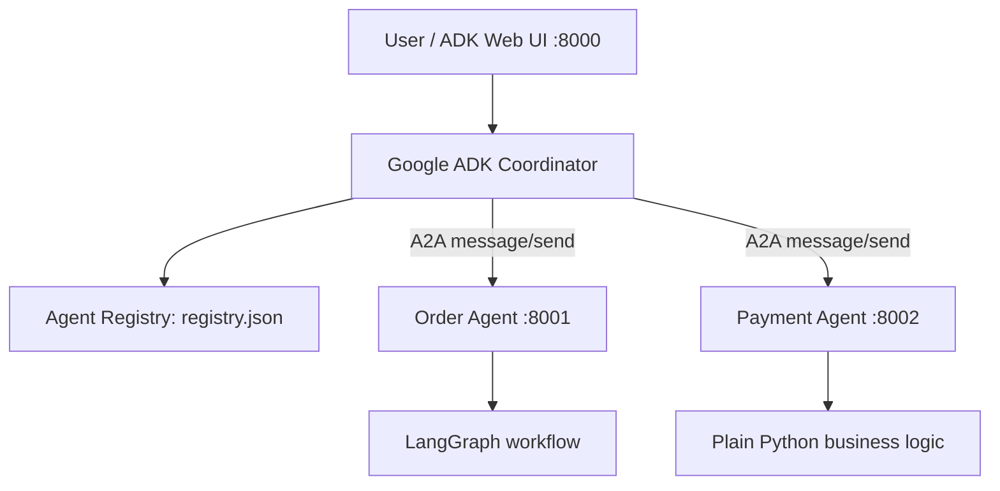

# Distributed A2A Agent Communication POC

A local demonstration of **agent discovery + Agent Cards + A2A calls** with independently running services.

## What this POC demonstrates

- **Coordinator:** Google ADK agent (port `8000`) with tools to discover agents from a registry and call them.
- **Order Agent:** specialist business logic implemented as a LangGraph workflow (port `8001`).
- **Payment Agent:** specialist business logic implemented with plain Python (port `8002`).
- **A2A transport:** the specialist services expose Agent Cards and accept A2A `message/send` JSON-RPC requests.
- **Registry:** `registry.json` maps capabilities to agent base URLs. The coordinator reads it at request time; it does not assume it knows every agent in advance.

> POC scope: the registry is a local JSON file and the demo data is mocked. This is for local learning/demo only, not production security or payment processing.

## Architecture



## Prerequisites

- Python 3.11 or 3.12
- A Google AI API key if using Gemini through Google ADK
- Internet access during dependency installation

## Setup (PowerShell)

From this directory:

```powershell
py -3.11 -m venv .venv
.\.venv\Scripts\Activate.ps1
python -m pip install --upgrade pip
pip install -r requirements.txt
Copy-Item .env.example .env
```

Edit `.env` and set `GOOGLE_API_KEY`. Do not commit `.env`.

## Start the services

Open **four terminals** in the project root. Activate the virtual environment in each terminal.

**Terminal 1 — Order Agent (port 8001)**

```powershell
uvicorn agents.order_agent:app --host 127.0.0.1 --port 8001
```

**Terminal 2 — Payment Agent (port 8002)**

```powershell
uvicorn agents.payment_agent:app --host 127.0.0.1 --port 8002
```

**Terminal 3 — Coordinator UI (port 8000)**

```powershell
adk web coordinator --port 8000
```

**Terminal 4 — health / card checks**

```powershell
Invoke-RestMethod http://127.0.0.1:8001/.well-known/agent-card.json
Invoke-RestMethod http://127.0.0.1:8002/.well-known/agent-card.json
Invoke-RestMethod http://127.0.0.1:8000
```

Open `http://127.0.0.1:8000`, select `coordinator`, and ask:

> Check order ORD-1001 and tell me its payment status.

Expected demo data:

- Order `ORD-1001`: shipped, estimated delivery `2026-10-14`
- Payment `ORD-1001`: paid, amount `129.95 USD`

Try `ORD-1002` too to see a different result.

## Verify direct A2A calls without the LLM

Run the built-in smoke test after starting the Order and Payment agents:

```powershell
python -m tests.smoke_test
```

This calls the A2A `message/send` method directly and checks the response. The smoke test validates connectivity/protocol shape independently of the coordinator's model.

## How discovery works

1. Each agent serves its own card at `/.well-known/agent-card.json`.
2. `registry.json` stores agent names, capabilities, and base URLs.
3. The coordinator's `discover_agents` tool reads the registry when invoked.
4. The coordinator selects an agent based on its capability.
5. `call_agent` sends an A2A JSON-RPC `message/send` request to the selected endpoint.
6. The result is returned to the coordinator, which summarizes it for the user.

The registry is deliberately a separate concept from Agent Cards: **the registry helps find agents; the card describes an agent; A2A carries the request and response.**

## Troubleshooting

- **`GOOGLE_API_KEY` missing:** set it in `.env`, then restart `adk web`.
- **Port already in use:** change the port and update the matching URL in `registry.json`.
- **Card loads but call fails:** check that the card's `url` and registry `base_url` match the actual service URL.
- **Dependency/API mismatch:** this POC uses the A2A Python SDK 0.3.x API family for a compact teaching implementation. The current A2A project recommends targeting SDK 1.x for new production integrations; see the references and migration note in `docs/TECHNICAL_DESIGN.md`.
- **Model doesn't call tools:** ask explicitly to “discover the order agent and call it for ORD-1001,” then inspect the coordinator tool instructions and logs.

## Files

- `docs/IMPLEMENTATION_PLAN.md` — phases and acceptance criteria
- `docs/TECHNICAL_DESIGN.md` — architecture and protocol flow
- `docs/DEMO_SCRIPT.md` — manager demonstration script
- `docs/PRESENTATION_OUTLINE.md` — slide-by-slide talking points
- `coordinator/agent.py` — Google ADK coordinator and tools
- `agents/order_agent.py` — LangGraph specialist wrapped in A2A
- `agents/payment_agent.py` — Python specialist wrapped in A2A
- `registry.json` — simple capability registry
- `tests/smoke_test.py` — direct protocol smoke test
