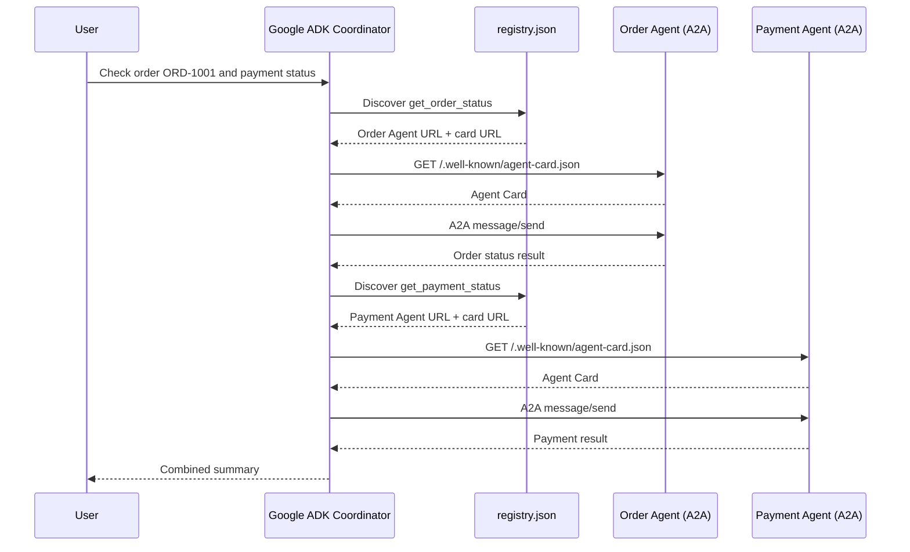

# Technical Design: Distributed Agent Communication POC

## 1. Summary

This POC demonstrates three independent processes:
- Google ADK coordinator.
- LangGraph Order Agent.
- Plain-Python Payment Agent.

The specialist agents expose A2A-compatible endpoints and Agent Cards. The coordinator reads a registry to discover endpoints, fetches a card, and submits a JSON-RPC `message/send` request.

## 2. Core concepts

### Registry
A lookup mechanism mapping an agent ID or capability to the endpoint/card URL. It answers: **where might the agent be, and what capability is registered?**

### Agent Card
A machine-readable description served by the agent. It includes identity, endpoint, supported capabilities, and skills. It answers: **what does this agent advertise that it can do?**

### A2A
The protocol used to send tasks/messages to another agent and receive task results. It answers: **how do the two agents exchange work?**

These are separate responsibilities. A card is not itself a registry, and publishing a card does not automatically make an agent discoverable.

## 3. Components

### Coordinator
`coordinator/agent.py` creates a Google ADK `Agent` with two tools:
- `discover_agents(capability)`: reads `registry.json`, optionally filtering by capability.
- `call_agent(agent_id, message)`: fetches the card, checks that the advertised endpoint matches the local registry allowlist, then sends an A2A JSON-RPC request.

The LLM chooses when to use the tools based on its instructions and the user's request. Direct protocol verification does not depend on the LLM; use `tests/smoke_test.py`.

### Order Agent
`agents/order_agent.py` implements order lookup as a small LangGraph workflow and wraps it in the A2A Python SDK server components.

### Payment Agent
`agents/payment_agent.py` implements deterministic lookup logic in plain Python and wraps it in the same A2A server interface.

The shared protocol means the coordinator does not need to know the internal framework of either specialist.

## 4. Request flow



## 5. Example request

The coordinator sends a JSON-RPC request to a registered agent:

```json
{
  "jsonrpc": "2.0",
  "id": "poc-call-001",
  "method": "message/send",
  "params": {
    "message": {
      "messageId": "poc-message-001",
      "role": "user",
      "parts": [
        {"type": "text", "text": "Check order ORD-1001"}
      ]
    }
  }
}
```

The exact wire schema depends on the pinned A2A SDK/protocol version. Keep the SDK and protocol versions aligned when upgrading.

## 6. Why different frameworks work

The Order Agent uses LangGraph to run its business workflow; the Payment Agent uses ordinary Python functions. Both adapt their work to the same A2A interface. The coordinator communicates with the protocol boundary, not the internal framework.

A2A does not require all agents to share the same model, framework, language, or host. They do need compatible protocol implementations and reachable endpoints.

## 7. Security notes

This local POC is not production hardened:
- It uses loopback HTTP and no authentication.
- The registry is a local JSON file.
- The endpoint check is a demo allowlist, not cryptographic card verification.
- Demo data is hardcoded.
- There is no rate limiting, durable task store, distributed tracing, or formal retry policy.

Production recommendations:
- Use TLS and authenticated service-to-service requests.
- Restrict network access and apply least-privilege authorization.
- Trust cards only from approved registries/domains; consider signed Agent Cards and signature verification.
- Validate inputs and bound payload sizes/timeouts.
- Add structured logs, correlation IDs, retries with backoff, and idempotency for side-effecting tasks.
- Store secrets in a secret manager; never commit `.env`.
- Require human confirmation and backend authorization for sensitive operations.

## 8. Version note

This compact POC pins the A2A Python SDK to the 0.3.x API family to keep the server executor example straightforward. Current official ADK guidance states that ADK supports both A2A SDK 0.3.x compatibility and 1.x, and recommends targeting 1.x for new integrations. Before adopting this code beyond a demo, migrate and test the server/client against the current SDK 1.x API using the official migration guide.

References:
- Google ADK A2A overview: https://adk.dev/a2a/
- ADK exposing an agent: https://adk.dev/a2a/quickstart-exposing/
- ADK consuming an agent: https://adk.dev/a2a/quickstart-consuming/
- A2A Python SDK samples: https://a2aproject.github.io/a2a-python/samples/
- A2A protocol: https://a2a-protocol.org/latest/
